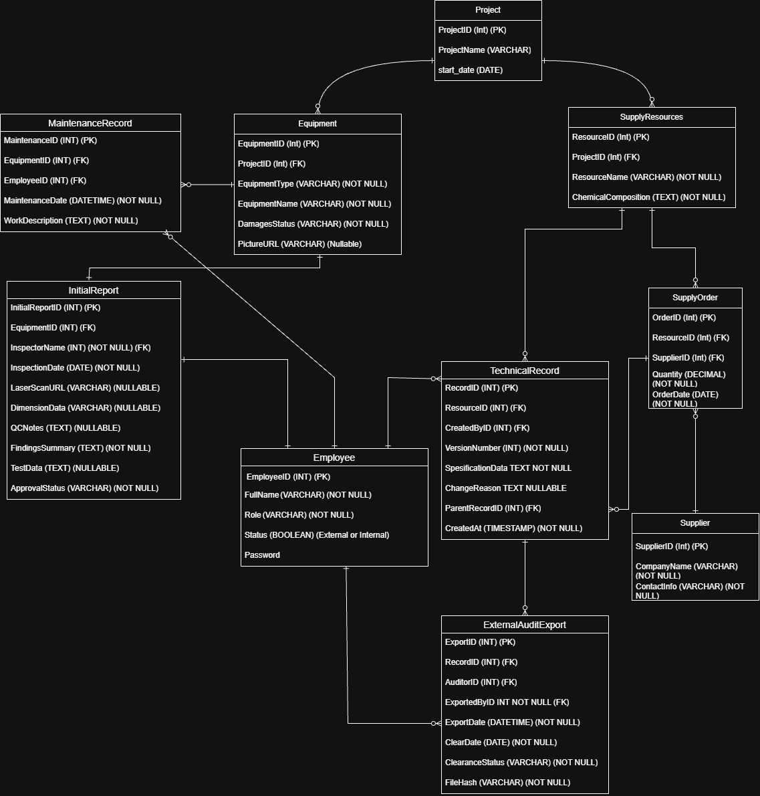
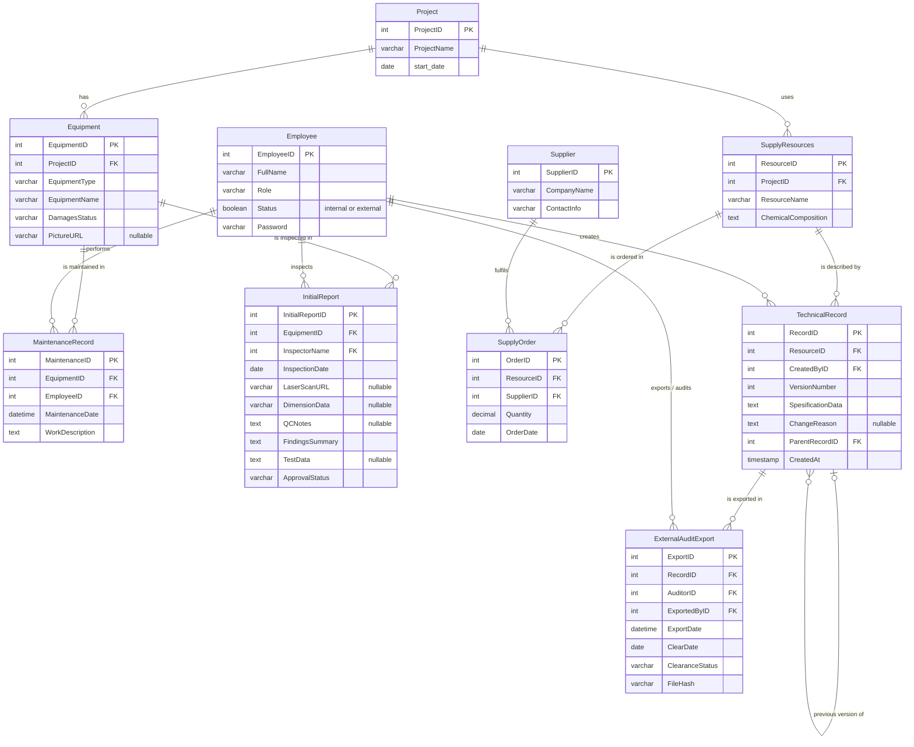

# COS20031 – Supply Chain Database for Precision Asset and Supplier Management

Group assignment for **COS20031 Database Design Project** at Swinburne University of Technology (Sarawak).
The project designs and builds a relational database that tracks engineering components, their suppliers, and their technical/quality records.

---

## Project Background

In high-precision engineering, every ordered component is inspected. Engineers produce technical and compliance data such as stress-test reports, QC notes, laser scans and dimensions. That data is linked to the exact object tested and the supplier who provided it.

Key business rules from the brief:

- An object can come from **many suppliers**, and a supplier can provide **many objects**.
- Technical records can be **amended**, but old versions must **never be lost**. Engineers must be able to view the full version history.
- Raw material **chemical composition** data does **not change** over time.
- Faulty components may be sent to **external auditors**. The exported files must be tracked, protected against leaks, and **cleared/returned** once the audit is finished.

## Objective

Design and develop a database system that improves component sourcing and quality-data management for everyone involved: engineers, inspectors, technicians, managers and external auditors.

## Scope

The database captures:

1. Suppliers
2. Objects (components / equipment / supply resources)
3. Technical and quality records (with version history)
4. Projects, employees, maintenance, inspections, supply orders and audit exports

### Technical requirements

| Requirement | How it is handled |
|---|---|
| Relational DBMS | SQL scripts for creating and populating the database |
| Role-based access control | `Employee.Role` decides what each user can read or change |
| Encryption of sensitive data | Login passwords stored as salted hashes, never plain text |
| Non-destructive edits | `TechnicalRecord.VersionNumber` + `ParentRecordID` keep every old version |
| Secure audit exports | `ExternalAuditExport` logs who exported what, to which auditor, a `FileHash` to detect tampering, and the clearance status |

---

## Entity Relationship Diagram





### Tables at a glance

| Table | Purpose |
|---|---|
| `Project` | An engineering project that owns equipment and resources |
| `Equipment` | Physical equipment/components used in a project, with damage status and photo |
| `MaintenanceRecord` | Each maintenance job done on equipment and who did it |
| `InitialReport` | First inspection of equipment: laser scans, dimensions, QC notes, test data, approval |
| `Employee` | Internal staff and external auditors, with their role and login |
| `SupplyResources` | Materials/components a project needs, including fixed chemical composition |
| `Supplier` | Companies that supply resources |
| `SupplyOrder` | Junction table: which supplier supplied which resource, how much, and when (handles the many-to-many) |
| `TechnicalRecord` | Versioned specification records. Each edit makes a new row pointing to its parent version |
| `ExternalAuditExport` | Log of records sent to external auditors, with file hash and clearance tracking |

---

## Assessment Deliverables

| Part | Deliverable | Due | Weight |
|---|---|---|---|
| 1 | Project Proposal (Confluence export: team home, plan, roles, risks, persona, empathy map, requirements, initial ERD) | Week 4 | 20 pts |
| 2 | Progress Report (Confluence export, Jira PNG, Team Health Monitor) | Week 7 | 5 pts |
| 3 | Product Video (3 minutes, every member speaks) | Week 12 | 10 pts |
| 4 | Final Report (ERD + reviews, CREATE TABLE scripts, data creation, use cases & SQL, indexes, retrospective, specialised enhancements, Jira exports) | Week 12 | 25 pts |

## Repository Structure (planned)

```
.
├── README.md
├── docs/
│   └── ERD.png            # entity relationship diagram
├── schema/
│   └── create_tables.sql  # CREATE TABLE statements and constraints
├── data/
│   └── insert_data.sql    # sample data for every table
├── queries/
│   ├── use_cases.sql      # SQL for each use case
│   └── indexes.sql        # index tests for performance
└── security/
    └── roles.sql          # role-based access and password hashing
```

## Getting Started

1. Clone the repository:
   ```bash
   git clone https://github.com/hsyn-ali/COS20031-SQL-Database.git
   cd COS20031-SQL-Database
   ```
2. Create the tables: run `schema/create_tables.sql` in your DBMS.
3. Load sample data: run `data/insert_data.sql`.
4. Try the use cases: run the queries in `queries/use_cases.sql`.

## Team

| Name | Student ID | Role |
|---|---|---|
| Hassan Ali Shah SYED | 105797705 | Developer |
| Kevin Emmanuel Rusli | 105801758 | Developer |
| Hui Ming TANG | 104399731 | Developer |
| Darryl Ho Yung Hwa | 104396017 | Product Owner |
| Ali Murtaza Shah SYED | 1044007320 | Scrum Master |

## Tools

- **Database:** relational DBMS (SQL)
- **Diagrams:** draw.io
- **Project management:** Jira
- **Documentation:** Confluence
- **Version control:** Git / GitHub

---

*Swinburne University of Technology Sarawak – COS20031 Database Design Project, Semester 2 2026.*
